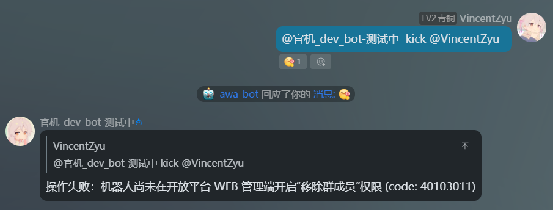
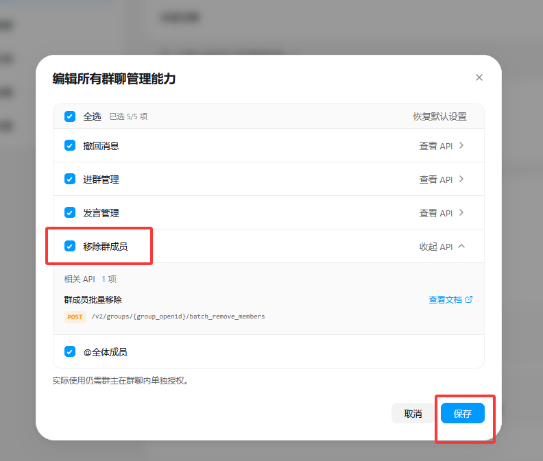
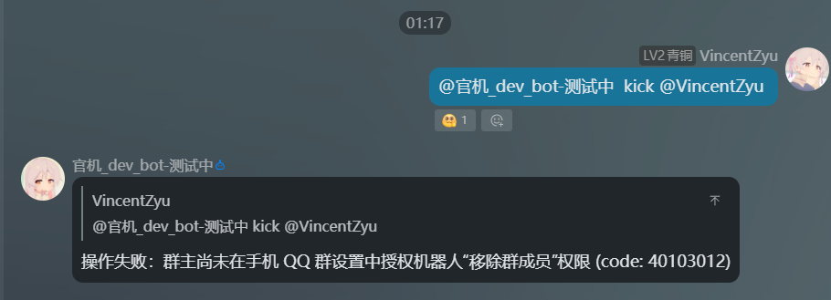
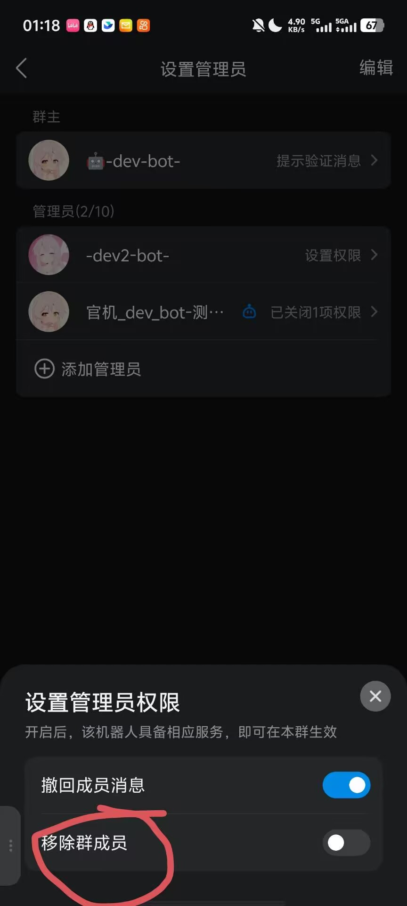

# 常见问题

## `stream` 为什么有时候是布尔值，有时候是对象？

这是当前适配器的兼容设计。

### `stream: true`

表示使用适配器内部的快捷流式首包写法，也就是自动附加：

- `state = 1`

### `stream: { ... }`

表示你自己直接传 QQ 官方原始流式对象。

例如：

```ts
stream: {
  state: 10,
  id: streamId,
  index: 1,
  reset: true,
}
```

也就是说，`stream` 现在统一只有一个名字，只是支持两种值类型。

## `stream: true` 为什么不会自动结束？

这是当前刻意保留的行为。
适配器只负责帮你进入流式状态，不自动决定何时结束。

原因是不同消息的结束时机很难统一，而且自动补 `state = 10` 容易导致：

- 重复消息
- 空消息
- 主动消息权限错误
- 不同客户端表现不一致

所以现在如果你要结束流式，请自己传原始 `stream` 对象。

## 为什么 Windows QQ 和手机 QQ 的 Markdown 显示不一样？

这是 QQ 客户端本身的差异。
同一条原生 Markdown 消息，在不同端的渲染和复制结果可能不同，尤其是下面这些内容：

- 方括号链接
- 分隔线
- 代码块
- 蓝字按钮

如果某类消息需要跨端显示尽量一致，建议：

- 保持 Markdown 简单
- 少用复杂链接语法
- 必要时关闭 `autoStreamText`

## `autoStreamText` 开了以后，为什么普通文本看起来像 Markdown？

因为这个开关的实现方式就是：

- 检测到纯文本
- 改成 QQ 原生 Markdown 消息发送
- 再附加流式首包

所以开启后，本质上已经不是“普通文本消息”了。

## 私聊 `channelId` 为什么是 `private:xxxx`？

这是适配器内部约定的私聊频道 ID 格式：

```text
private:{userId}
```

这样可以明确区分：

- 群聊 `channelId`
- 私聊 `channelId`

并且你可以统一调用：

- `sendMessage(channelId, ...)`
- `deleteMessage(channelId, messageId)`

适配器会在内部自动还原真实 QQ 用户 ID。

## `qq zombied connection` 是什么？

这是心跳检测发现连接已经僵死。
适配器现在会在这种情况下立即重连，而不是完全依赖默认的重试间隔。

所以看到这条日志不一定代表插件出故障，更像是一次主动的快速自恢复。

## 为什么群里能拿到用户名，私聊里却拿不到？

这是 QQ 官方事件内容本身的差异。
有些 WebSocket 事件会带 `author.username`，有些不会。

适配器现在会：

- 优先使用事件里带来的用户名
- 写入数据库
- 后续再从缓存或数据库回填到 `session.username`

所以第一次可能拿不到，后面同一用户就更稳定了。

## 移除群成员遇到 40103011 或 40103012 错误怎么办？

腾讯官方对机器人的“移除群成员”权限采取了严格的**双重安全授权机制**，必须同时满足以下两个条件才能成功执行移除操作：

### 1. 错误码 `40103011`：开放平台 WEB 管理端未开通权限

- **现象**：适配器捕获并提示：`操作失败：机器人尚未在开放平台 WEB 管理端开启“移除群成员”权限 (code: 40103011)`
- **排查与解决**：
  1. 登录 [QQ 开放平台管理端](https://q.qq.com/)；
  2. 进入机器人详情 -> 权限管理 -> 群管理权限；
  3. 勾选并开通 **“移除群成员”** 权限接口。





---

### 2. 错误码 `40103012`：群主尚未在手机 QQ 群设置中授权

- **现象**：适配器捕获并提示：`操作失败：群主尚未在手机 QQ 群设置中授权机器人“移除群成员”权限 (code: 40103012)`
- **排查与解决**：
  1. 必须由**群主本人**打开手机 QQ；
  2. 进入该群 -> 群聊设置 -> **群机器人**；
  3. 找到并点击当前机器人 -> 勾选开启 **“移除成员”** 权限开关。





::: tip 温馨提示
适配器现已自动拦截 `40103011` 与 `40103012` 错误，并将其转换为友好的 `SessionError` 直接反馈给交互上下文，避免因权限缺失导致整个会话崩溃报“发生未知错误”。
:::
